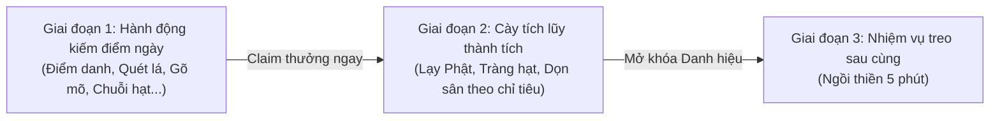

# 🪷 Tự Động Hóa Chùa Online (didenchua.online)

Hệ thống tự động hóa công đức, điểm danh và làm nhiệm vụ hàng ngày cho [An Tự Duyên - didenchua.online](https://didenchua.online/?phong=chua-1).

> 📖 **TÀI LIỆU TOÀN DIỆN MASTER:** Đọc tài liệu chi tiết đầy đủ 100% về kiến trúc, 4 tab hồ sơ tu tập, 17 danh hiệu, 12 pháp khí, bản đồ 3D 17 thắng cảnh, 31 tác vụ 5 tầng, và cẩm nang vận hành tại:  
> 👉 [**PROJECT_DOCUMENTATION.md**](PROJECT_DOCUMENTATION.md)

Hỗ trợ 2 chế độ:
1. **Chạy ngầm siêu nhẹ qua WebSocket**: Tiêu tốn < 20MB RAM, không cần mở Chrome, cày điểm và làm nhiệm vụ trong vài giây.
2. **Mở trình duyệt ảo (Google Chrome 3D)**: Xem trực tiếp nhân vật, không gian chùa 3D, đồng bộ tài khoản giữa tool và trình duyệt.

---

## 🛠️ Cài đặt nhanh

Mở Terminal tại thư mục này và kiểm tra thư viện:
```bash
npm install
```

---

## 📋 Cách dùng: Chạy từng nhiệm vụ & Cày số lượng

Bạn có thể truyền thêm **số lượng** mong muốn vào sau mỗi lệnh:

| Lệnh npm / CLI | Mô tả hành động & Tùy chọn số lượng |
| :--- | :--- |
| `npm run status` | Xem cấp bậc, điểm công đức và tiến độ 4 nhiệm vụ hàng ngày |
| `npm run secrets`<br>*(hoặc `npm run an`)* | **TỰ ĐỘNG CHẠY TOÀN BỘ NHIỆM VỤ ẨN & TÍNH NĂNG MỞ RỘNG TRÊN CHÙA** (Gieo quẻ, Dâng hương Quan Âm, Trồng hoa, Tùy hỷ, Thư pháp, Thăm 10 khu, Khóa tụng kinh...) |
| `npm run journal`<br>*(hoặc `npm run danhhieu`)* | **Xem bảng thành tựu & tiến độ số lượng** (Lạy Phật, Dâng hương, Thả đèn, Khám phá chùa...) |
| `npm run checkin` | Điểm danh nhận quà hàng ngày (chuỗi 7 ngày nhận tràng hạt hiếm) |
| `node cli.js quet [số lần]`<br>*(vd: `node cli.js quet 20`)* | **Quét lá sân chùa N lần** (mặc định 1 lần, có thể quét 10, 20 lần...) |
| `node cli.js lay [số lạy]`<br>*(vd: `node cli.js lay 108`)* | **Lạy Phật N lạy** (mặc định 108 lạy để cày danh hiệu *"Trăm lạy"*) |
| `node cli.js huong [số nén]`<br>*(vd: `node cli.js huong 30`)* | **Dâng N nén hương** (đạt 30 lần mở danh hiệu *"Hương trầm"*) |
| `node cli.js den [số ngọn]`<br>*(vd: `node cli.js den 10`)* | **Thả N ngọn hoa đăng** (đạt 10 ngọn mở danh hiệu *"Người thả đèn"*) |
| `npm run tham`<br>*(hoặc `node cli.js tham`)* | **Đi thăm đủ 10 khu vực trong chùa** (mở danh hiệu *"Thăm khắp chùa"*) |
| `npm run chao` | Chắp tay chào một bạn đồng tu đang ở trong chùa |
| `node cli.js mo [số tiếng]`<br>*(vd: `node cli.js mo 100`)* | Tụng kinh gõ mõ N tiếng tích công đức (mặc định 30 tiếng) |
| `node cli.js chuoi [số hạt]`<br>*(vd: `node cli.js chuoi 108`)* | Lăn N hạt chuỗi tràng niệm Phật (108 hạt để tròn 1 chuỗi) |
| `npm run meditate -- [số giây]`<br>*(vd: `npm run meditate -- 3600`)* | Ngồi thiền qua giao diện Chrome của game; trạng thái journal được đối chiếu sau khi xong |
| `npm run chores` | Làm công quả trọn gói: quét sân, thả cá, thắp đèn, chăm mèo, tưới sen |
| `npm run claim` | Tự động kiểm tra và nhận tất cả quà nhiệm vụ đã xong |
| `npm run farm`<br>*(hoặc `npm run thanhtich`)* | **Cày tích lũy thành tích vĩnh viễn** theo chỉ tiêu đặt trong `config.json` (Lạy Phật, Lăn hạt tràng, Quét dọn sân chùa, Dâng hương, Thả hoa đăng...) |

---

> **Lưu ý về thiền:** Hành động `visit` chỉ ghi nhận khu vực, không đặt nhân vật ngồi. Lệnh thiền cần Chrome và thao tác UI **Động tác → Ngồi thiền tại chỗ** để game phát trạng thái ngồi cùng vị trí thật. Client WebSocket thuần từ chối giả lập tư thế hoặc claim chỉ dựa trên đồng hồ cục bộ.

## ⚡ Chu trình chuẩn hóa 3 Giai đoạn (CI/CD & Combo tự động)

Quy trình tự động hóa được thiết kế tối ưu và chặt chẽ qua **3 Giai đoạn**:



1. **GIAI ĐOẠN 1: HÀNH ĐỘNG KIẾM ĐIỂM NGÀY (ACTION TASKS - LÀM TRƯỚC)**
   - Thực hiện toàn bộ: Điểm danh, Dâng hương, Thả hoa đăng, Chào hỏi, Quét lá sân chùa, Cho cá ăn, Thắp đèn dầu, Chăm mèo, Tưới sen, Gõ mõ, Lăn hạt, Thỉnh chuông.
   - **Chốt nhận thưởng (ClaimAll) ngay lập tức** để khóa trọn vẹn công đức ngày, chống mất dữ liệu khi gián đoạn mạng.

2. **GIAI ĐOẠN 2: CÀY TÍCH LŨY THÀNH TÍCH (MILESTONE FARMING - CÀY THÀNH TỰU VĨNH VIỄN)**
   - Các hành động dù ngày hôm đó không còn cộng thêm điểm công đức ngày nữa, nhưng vẫn liên tục được ghi nhận vào Sổ công đức vĩnh viễn để mở khóa danh hiệu:
     - **Lạy Phật**: Mốc 108 lạy mở danh hiệu 🏆 *"Trăm lạy"*, mốc 1.000 lạy mở *"Ngàn lạy"*.
     - **Chuỗi tràng hạt**: Mốc 108 hạt mở 🏆 *"Tròn chuỗi hạt"*, mốc 100 chuỗi mở *"Trăm chuỗi hạt"*.
     - **Quét dọn sân chùa**: Tích lũy số lần làm sạch sân chùa (công quả).
     - **Dâng hương**: Mốc 30 lần mở *"Hương trầm"*.
     - **Thả hoa đăng**: Mốc 10 ngọn mở *"Người thả đèn"*.
   - Cho phép người dùng chọn **mức độ (quota)** muốn cày mỗi ngày trong `config.json` (hoặc lệnh `npm run farm`).

3. **GIAI ĐOẠN 3: NHIỆM VỤ TREO / TĨNH TÂM (HANGING TASKS - LÀM SAU CÙNG)**
   - Chỉ chuyển qua sau khi đã hoàn tất cả hành động kiếm điểm lẫn cày thành tích.
   - Ngồi thiền tĩnh tâm 5 phút và nhận quà nhiệm vụ `ngoi` sau cùng.

### Các lệnh chạy Combo & CI/CD:
```bash
# Chạy trọn vẹn cả 3 giai đoạn:
npm run all
# hoặc
npm run quests

# Chạy nhanh (bỏ qua nhiệm vụ treo 5 phút để hoàn thành trong 1-2 phút):
node cli.js all --fast

# Chỉ cày thành tích vĩnh viễn theo chỉ tiêu:
npm run farm
# hoặc tự truyền chỉ tiêu: node cli.js farm [số lạy] [số hạt] [số lần quét]
node cli.js farm 18 88 5
```

---

## 👁️ Vừa mở trình duyệt vừa chạy tự động để xem (`npm run watch`)

> **Lưu ý quan trọng từ máy chủ:** Mỗi tài khoản (`CID`) chỉ được phép kết nối **1 phiên duy nhất**. Nếu bạn đang mở chùa trên trình duyệt mà lại chạy thêm lệnh terminal ngầm (`npm run ...`) thì máy chủ sẽ báo *"Chùa đang mở ở nơi khác"* và ngắt kết nối trình duyệt cũ.
> 
> 👉 **Để giải quyết triệt để, hãy dùng lệnh:**
```bash
npm run watch
```
Lệnh này sẽ:
1. Tự động mở Google Chrome 3D lên màn hình máy tính của bạn.
2. Điều khiển **trực tiếp qua kết nối duy nhất của Chrome** (không mở thêm kết nối ngầm nào).
3. Tự động thực hiện các hành vi: dâng hương, thả hoa đăng, chào bạn đồng tu, gõ mõ, làm công quả... ngay trên màn hình 3D trước mắt bạn!
4. **Không bao giờ bị báo "đang đăng nhập ở chỗ khác"**!

---

## 🌐 Mở trình duyệt để tự đi dạo ngắm cảnh (3D View)

Nếu bạn chỉ muốn mở trình duyệt lên để tự tay chơi hoặc ngắm cảnh chùa:

```bash
npm run browser
```

---

## ⏰ Chạy ngầm liên tục 24/7 (Daemon)

Để tool chạy ngầm liên tục, tự động làm nhiệm vụ và giữ chuỗi điểm danh mỗi khi bước sang 0h sáng ngày mới:

```bash
npm run daemon
```

---

## ⚙️ Cấu hình nhân vật & Chế độ An Toàn (`config.json`)

Mở file `config.json` để tùy chỉnh thông tin hoặc liên kết với nhân vật bạn đang chơi trên trình duyệt:

```json
{
  "cid": "YOUR_ACCOUNT_CID",
  "name": "phat-tu",
  "kind": "tieu",
  "robe": "nau",
  "skin": "dong",
  "bio": "Nam Mô A Di Đà Phật · Thân tâm thường an lạc",
  "beads": "go",
  "cushion": "xam",
  "room": "chua-1",
  "safeMode": true,
  "minDelaySec": 3.5,
  "maxDelaySec": 7.0,
  "chromePath": "/Applications/Google Chrome.app/Contents/MacOS/Google Chrome"
}
```

### 🛡️ Cơ chế Chống Chặn & Giãn Cách Tự Nhiên (Safe Human Mode):
- **`safeMode: true`**: Tự động chèn các khoảng nghỉ ngẫu nhiên (`3.5s` - `7.0s`) giữa các hành vi để mô phỏng y hệt người dùng đang thong thả đi dạo, ngắm cảnh và thắp hương trong chùa 3D.
- **Gõ mõ / Lăn tràng hạt**: Thay vì bắn liên tục, bot gõ nhịp nhàng 1-3 tiếng mõ rồi nghỉ 2.2s - 3.7s, tái hiện đúng nhịp điệu tụng kinh trang nghiêm.
- **Tùy chỉnh tốc độ**: Nếu muốn an toàn tuyệt đối hoặc chạy chậm rãi hơn nữa, bạn có thể tăng `minDelaySec` và `maxDelaySec` lên (ví dụ: `5.0` và `10.0`).

---

## ☁️ Triển khai lên Render.com (Web Dashboard & Tự Động Báo Cáo)

Hệ thống đã được thiết kế sẵn một **Web Dashboard giao diện chùa hiện đại** (`server.js`) và file cấu hình tự động [`render.yaml`](render.yaml) để deploy lên **Render Free Cloud**:

### 🌟 Tính năng khi chạy trên Render:
- 📱 **Web Dashboard trực quan**: Mở `https://<ten-app>.onrender.com` trên điện thoại xem ngay tổng công đức, cấp bậc, 4 nhiệm vụ ngày, bảng danh hiệu và tiến độ thành tựu.
- ⚡ **Nút bấm "Chạy Ngay" trên web**: Bấm 1 nút trên điện thoại để bot lập tức làm nhiệm vụ.
- 🔐 **Mật khẩu bảo vệ kích hoạt tác vụ (`11012006`)**: Bắt buộc nhập mật khẩu `11012006` mới kích hoạt được tác vụ, tránh bấm nhầm cướp session khi bạn đang tự tay chơi game trong chùa.
- ⏰ **Tự động canh 00:05 sáng (giờ VN)**: Tự động chạy chu trình 3 giai đoạn mỗi ngày.
- 📲 **Báo cáo tự động qua Telegram / Discord**: Tự động gửi tin nhắn tổng kết công đức và chúc mừng danh hiệu mới về điện thoại của bạn.
- 🔌 **API & Webhook Cron**: Hỗ trợ endpoint `/cron` hoặc `/run` để kết hợp với UptimeRobot hoặc Cron-job.org.

---

### 🚀 Cách triển khai lên Render trong 3 bước:

#### Cách 1: Sử dụng Render Blueprint (Nhanh nhất - 1 Click)
1. Đưa toàn bộ thư mục code này lên repository GitHub của bạn.
2. Đăng nhập [render.com](https://render.com) ➔ Chọn **Blueprints** ➔ Bấm **New Blueprint Instance**.
3. Chọn repo `didenchua` của bạn. Render sẽ tự động đọc file [`render.yaml`](render.yaml) và cấu hình sẵn mọi thứ.
4. Bấm **Apply** để hoàn tất!

#### Cách 2: Tạo thủ công Web Service trên Render
1. Bấm **New +** ➔ Chọn **Web Service**.
2. Kết nối repo GitHub của bạn.
3. Điền cấu hình:
   - **Name**: `didenchua-bot`
   - **Runtime**: `Node`
   - **Build Command**: `npm install`
   - **Start Command**: `npm start`
   - **Plan**: `Free`
4. Tại phần **Environment Variables**, thêm các biến:
   - `CID`: `YOUR_ACCOUNT_CID` (Bắt buộc - CID tài khoản của bạn)
   - `NAME`: `phat-tu` (Tùy chọn - Tên hiển thị)
   - `ROOM`: `chua-1` (Tùy chọn - Phòng chùa mặc định)
   - `AUTH_TOKEN`: `YOUR_SECRET_TOKEN` (Tùy chọn - Mã bí mật bảo vệ API/Cron)
   - *(Tùy chọn nhận tin nhắn Telegram)*:
     - `TELEGRAM_BOT_TOKEN`: Token bot Telegram của bạn
     - `TELEGRAM_CHAT_ID`: Chat ID Telegram của bạn
5. Bấm **Deploy Web Service**.

> [!TIP]
> **Giữ Render luôn hoạt động hoặc đánh thức lúc 00:05:**
> Do gói Free của Render sẽ tự động tạm ngủ (sleep) sau 15 phút nếu không có ai truy cập web, bạn chỉ cần tạo 1 lịch hẹn miễn phí tại [cron-job.org](https://cron-job.org) hoặc [UptimeRobot](https://uptimerobot.com):
> - **URL**: `https://<ten-app-cua-ban>.onrender.com/cron`
> - **Thời gian**: Hàng ngày lúc `00:05` (hoặc ping mỗi 10 phút để giữ server thức 24/7).

---

## 🚀 Tích hợp CI/CD (GitHub Actions / GitLab CI)

Hệ thống được thiết kế theo kiến trúc 2 giai đoạn chuẩn hóa cho môi trường CI/CD:

1. **GIAI ĐOẠN 1: NHIỆM VỤ HÀNH ĐỘNG TỨC THỜI (ACTION TASKS - CHẠY TRƯỚC)**
   - Thực hiện toàn bộ: Điểm danh, Dâng hương, Thả hoa đăng, Chào hỏi, Quét lá sân chùa, Cho cá ăn, Thắp đèn dầu, Chăm mèo, Tưới sen, Gõ mõ, Lăn hạt, Thỉnh chuông.
   - **Chốt nhận thưởng (Claim) toàn bộ quà ngay lập tức**! Đảm bảo dù CI/CD có bị timeout thì 100% công đức đã được máy chủ lưu lại.

2. **GIAI ĐOẠN 2: NHIỆM VỤ TREO / TĨNH TÂM (HANGING TASKS - CHẠY SAU CÙNG)**
   - Ngồi thiền tĩnh tâm 5 phút và nhận quà nhiệm vụ `ngoi` sau cùng.

### Các lệnh CI/CD:
```bash
# Chạy Giai đoạn 1 (nhanh, ~1 phút) - phù hợp kiểm tra nhanh
npm run ci

# Chạy trọn vẹn cả Giai đoạn 1 và Giai đoạn 2 (đủ 5 phút thiền định)
npm run cicd -- --full
```

### File cấu hình sẵn GitHub Actions:
Đã có sẵn file cấu hình tại [`.github/workflows/didenchua-daily.yml`](.github/workflows/didenchua-daily.yml). Bạn chỉ cần:
1. Đưa mã nguồn lên repository GitHub của bạn.
2. Vào **Settings** ➔ **Secrets and variables** ➔ **Actions**.
3. Thêm Secret: `DIDENCHUA_CID` = `YOUR_ACCOUNT_CID`.
4. GitHub Actions sẽ tự động chạy mỗi ngày lúc **00:05 sáng** (giờ VN) để giữ chuỗi điểm danh và tích công đức hoàn toàn tự động!

